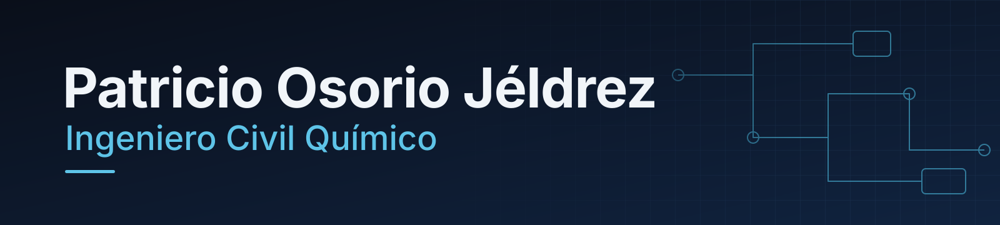

  

  <a href="README.md">English</a> &nbsp;·&nbsp; <b>Español</b> &nbsp;·&nbsp; <a href="https://www.linkedin.com/in/patricio-osorio-j%C3%A9ldrez-219122300/">LinkedIn</a>

## Sobre mí

Ingeniero civil químico con experiencia en ingeniería de proyectos, análisis de procesos industriales y automatización. Combino el criterio de ingeniería de procesos con la capacidad de desarrollar mis propias herramientas, para evaluar alternativas técnicas con datos y abordar problemas industriales de forma práctica y fundamentada.

- Radicado en Santiago, Chile. Abierto a oportunidades en ingeniería de procesos, proyectos y mejora continua.
- Idiomas: español (nativo), inglés (B2).

## Áreas de enfoque

- **Ingeniería de procesos:** balances de materia y energía, evaluación técnica y económica de mejoras en procesos y equipos.
- **Análisis de datos:** análisis de datos de proceso, diseño experimental y estadística en Python y R, dashboards en Power BI.
- **Automatización y herramientas:** herramientas en Python y C++, automatización con Excel/VBA, Power Apps para registros de inspección en terreno.
- **IA aplicada:** generación aumentada por recuperación (RAG) sobre documentación técnica, procesamiento documental e infraestructura de LLM propia.

## Herramientas

**Programación y datos** &nbsp; `Python` `R` `C++` `VBA` `Jupyter`

**Ingeniería y herramientas Microsoft** &nbsp; `Excel` `Power BI` `Power Apps` `Microsoft Lists`

**Entorno de desarrollo** &nbsp; `Linux` `Docker` `Git` `GitHub` `VS Code`

**IA aplicada** &nbsp; `RAG` `Embeddings y búsqueda vectorial` `Extracción documental` `LLM autoalojados`

**Seguridad de procesos** &nbsp; `HAZOP` `Cyber HAZOP` `Bow-Tie` `IEC 62443` `IEC 61511`

## Experiencia destacada

- **Ingeniero de Proyectos, Heracles SpA (2026).** Diseñé e implementé VECTOR, un sistema RAG para consultar documentación de ingeniería; desarrollé herramientas en Python y C++, una app de inspecciones en terreno con Power Apps, metodologías HAZOP / Cyber HAZOP y cursos técnicos. Este trabajo se hizo para un empleador y no es público.
- **Practicante de Ingeniería, ANDRITZ Chile (2025).** Evalué alternativas técnicas y económicas de mejora de procesos en plantas de celulosa y papel, con balances de materia y energía, análisis en Excel y reportes en Power BI.
- **Proyecto de habilitación profesional, Universidad del Bío-Bío (2025–2026).** Materiales compuestos plástico-madera (WPC) como alternativa a la madera tratada con CCA: diseño de experimento factorial, ensayos normalizados y análisis estadístico en Python y R.

## Trabajo destacado

Los repositorios públicos aparecerán aquí a medida que se publiquen. La idea es publicar herramientas pequeñas y bien documentadas que resuelvan problemas industriales concretos.
