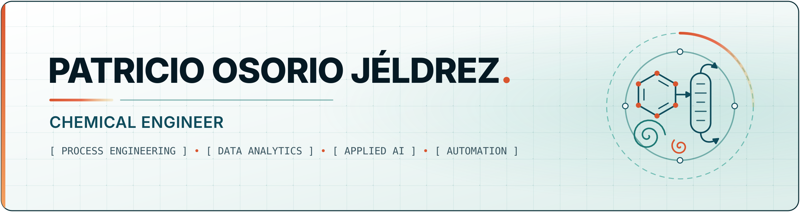

  <strong>🌐 Language:</strong> <kbd><strong>EN</strong></kbd> · <a href="README.es.md" title="Cambiar a Español">ES</a>

 

  <picture>
    <source media="(prefers-color-scheme: dark)" srcset="assets/banner-en-dark.png">
    <source media="(prefers-color-scheme: light)" srcset="assets/banner-en.png">
    
  </picture>

## About

Chemical engineer with experience in project engineering, industrial process analysis and automation. I combine process engineering judgment with the ability to build my own computational tools, so I can evaluate technical alternatives with data and approach industrial problems in a practical, well-grounded way.

- Based in Santiago, Chile. Open to opportunities in process, project and continuous-improvement engineering.
- Languages: Spanish (native), English (B2).
- LinkedIn: [Patricio Osorio Jéldrez](https://www.linkedin.com/in/patricio-osorio-j%C3%A9ldrez-219122300/)

## Focus areas

- **Process engineering:** mass and energy balances, technical and economic evaluation of process and equipment improvements.
- **Data analytics:** process data analysis, experimental design and statistics in Python and R, dashboards in Power BI.
- **Applied AI:** retrieval-augmented generation (RAG) over technical documentation, document processing and self-hosted LLM infrastructure.
- **Automation & tooling:** Python and C++ tools, Excel/VBA automation, Power Apps for field inspection records.

## Technical toolkit

**Programming & data**

**Engineering & Microsoft tools**

**Development environment**

**Applied AI** &nbsp; `RAG` `Embeddings & vector search` `Document extraction` `Self-hosted LLMs`

**Process safety** &nbsp; `HAZOP` `Cyber HAZOP` `Bow-Tie` `IEC 62443` `IEC 61511`

## Selected experience

- **Project Engineer, Heracles SpA (2026).** Designed and built VECTOR, a RAG system for querying engineering documentation; developed Python and C++ tools, a Power Apps field-inspection app, HAZOP / Cyber HAZOP methodologies and technical training courses. This work was done for an employer and is not public.
- **Engineering Intern, ANDRITZ Chile (2025).** Evaluated technical and economic alternatives for process improvements in pulp and paper plants, with mass and energy balances, Excel analysis and Power BI reporting.
- **Professional project, Universidad del Bío-Bío (2025–2026).** Wood-plastic composites (WPC) as an alternative to CCA-treated wood: factorial experiment design, standardized testing and statistical analysis in Python and R.

## Featured work

Public repositories will appear here as they are published. The plan is small, well-documented tools that solve concrete industrial problems.
